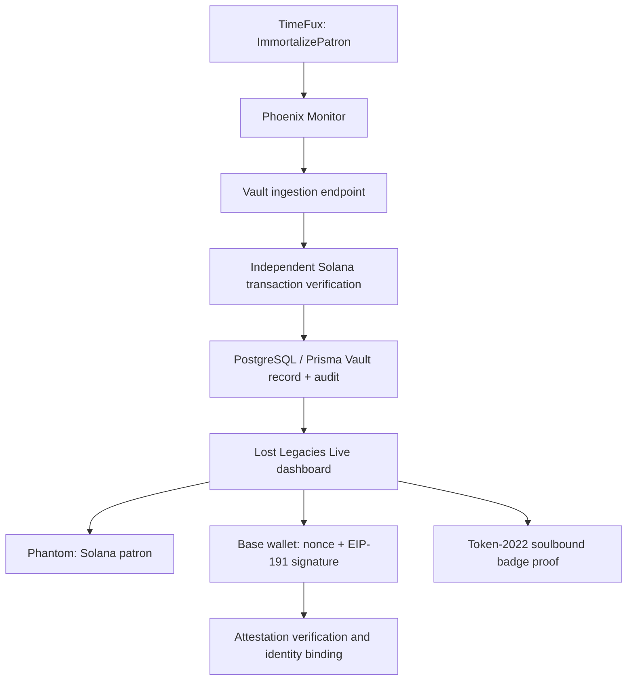

# Hardened Eternal Vault Integration Package

**Status:** Implementation proposal captured from the Lost Legacies Live project conversation.  
**Target environment:** Solana Devnet, Base, Next.js App Router, Prisma/PostgreSQL.  
**Repository branch:** `codex/six-segment-interoperability`

This document preserves the requested integration package: Phoenix ingestion, independent Solana verification, Devnet integration tests, identity-linking and soulbound-badge UI, and the Vault dashboard.

> **Implementation status:** This is a design/code handoff, not a claim that these files have been installed, compiled, tested, or deployed. The snippets below require repository-specific integration and validation. In particular, the dashboard and component JSX in the submitted material was partially lost in message formatting; reconstruct the presentation markup before treating those components as buildable source.

## 1. Hardened Vault Record API

Proposed file: `app/api/vault/record/route.ts`

```ts
import { NextRequest, NextResponse } from "next/server";
import { prisma } from "@/lib/prisma";
import { Connection, PublicKey } from "@solana/web3.js";
import { createHash } from "crypto";

const TIMEFUX_PROGRAM_ID = new PublicKey(
  process.env.NEXT_PUBLIC_TIMEFUX_PROGRAM_ID ||
    "TiMeFUXyR9nTgmiiQgx3wH2qzoyMiY5G4seySXMA9pP"
);

const connection = new Connection(
  process.env.HELIUS_RPC_URL || "https://api.devnet.solana.com",
  "confirmed"
);

export async function POST(req: NextRequest) {
  try {
    const body = await req.json();
    const { signature, expectedPatron } = body;

    if (!signature || typeof signature !== "string") {
      return NextResponse.json({ error: "Missing signature" }, { status: 400 });
    }

    const tx = await connection.getTransaction(signature, {
      commitment: "confirmed",
      maxSupportedTransactionVersion: 0,
    });

    if (!tx || tx.meta?.err) {
      return NextResponse.json({ error: "Transaction not found or failed" }, { status: 400 });
    }

    const accountKeys = tx.transaction.message.getAccountKeys().staticAccountKeys;
    const touchedTimeFux = accountKeys.some((k) => k.equals(TIMEFUX_PROGRAM_ID));
    if (!touchedTimeFux) {
      return NextResponse.json({ error: "Transaction did not invoke TimeFux program" }, { status: 400 });
    }

    const logs = tx.meta?.logMessages || [];
    const logStr = logs.join("\n");
    const isImmortalize =
      /Instruction:\s*ImmortalizePatron/i.test(logStr) ||
      /Instruction:\s*immortalize_patron/i.test(logStr);

    if (!isImmortalize) {
      return NextResponse.json({ error: "Not an ImmortalizePatron instruction" }, { status: 400 });
    }

    const patronMatch = logStr.match(/Patron:?\s+([1-9A-HJ-NP-Za-km-z]{32,44})/i);
    const solanaPatron = patronMatch?.[1] || expectedPatron;

    if (!solanaPatron) {
      return NextResponse.json({ error: "Could not extract patron" }, { status: 400 });
    }

    if (expectedPatron && expectedPatron !== solanaPatron) {
      return NextResponse.json({ error: "Patron mismatch" }, { status: 400 });
    }

    const slot = BigInt(tx.slot);
    const recordHash = createHash("sha256")
      .update(JSON.stringify({ signature, solanaPatron, slot: slot.toString() }))
      .digest("hex");

    const vault = await prisma.$transaction(async (txClient) => {
      const record = await txClient.vaultRecord.upsert({
        where: { timefuxSignature: signature },
        create: {
          solanaPatron,
          timefuxSignature: signature,
          slot,
          status: "VERIFIED",
        },
        update: {},
      });

      await txClient.vaultAuditEvent.create({
        data: {
          vaultRecordId: record.id,
          eventType: "IMMORTALIZED",
          actor: "phoenix-monitor",
          newState: { signature, solanaPatron, slot: slot.toString() },
          recordHash,
        },
      });

      return record;
    });

    return NextResponse.json({ success: true, vault });
  } catch (err: unknown) {
    console.error("[vault/record]", err);
    const message = err instanceof Error ? err.message : "Internal error";
    return NextResponse.json({ error: message }, { status: 500 });
  }
}
```

### Integration and security checks required

- The submitted verification checks static account keys. For versioned transactions, validate all relevant account keys, including address lookup table-loaded keys, and confirm the actual instruction program index.
- Do not treat log text alone as authoritative proof of the patron. Decode the program instruction/accounts or verify the program's canonical account state.
- Validate the signature format and ensure the transaction belongs to the configured cluster/program deployment.
- The request currently has no authentication or request-signature protection. Restrict this ingestion endpoint to an authenticated Phoenix service or signed webhook.
- Ensure duplicate delivery does not create duplicate audit events. Add a database uniqueness/idempotency key for the event, not only the Vault record.
- Validate the patron as a Solana public key before persistence.
- Avoid returning internal exception messages to callers in production.
- Confirm the Prisma model names and fields against the repository's actual schema before merging.

## 2. Phoenix Monitor → Vault Callback

Proposed integration in `scripts/phoenix-scream-monitor.ts`:

```ts
import { Connection, PublicKey, Logs, Context } from "@solana/web3.js";

const VAULT_API =
  process.env.VAULT_API_URL || "http://localhost:3000/api/vault/record";

async function notifyVault(signature: string, patron: string | null) {
  try {
    const res = await fetch(VAULT_API, {
      method: "POST",
      headers: { "Content-Type": "application/json" },
      body: JSON.stringify({ signature, expectedPatron: patron }),
    });
    const data = await res.json();

    if (!res.ok) {
      console.error("Vault rejected event:", data.error);
    } else {
      console.log("Vault recorded immortalization:", data.vault?.id);
    }
  } catch (err) {
    console.error("Failed to notify Vault:", err);
  }
}

// Invoke from the existing onLogs callback only after the monitor has
// identified the candidate ImmortalizePatron event. The Vault independently
// fetches and verifies the transaction before writing its ledger record.
if (isImmortalize || patron) {
  notifyVault(logs.signature, patron);
}
```

Production follow-up: await or queue the callback, add bounded retries with backoff, include a service-authentication signature, and ensure monitor restarts cannot lose events. The callback condition should be narrowed to a confirmed ImmortalizePatron instruction rather than `isImmortalize || patron` if patron data can appear in unrelated logs.

## 3. Devnet Integration Test Suite

Proposed file: `tests/vault.integration.test.ts`

```ts
import { describe, it, expect, beforeAll } from "vitest";
import { prisma } from "@/lib/prisma";

// Add a real Devnet fixture/helper that submits ImmortalizePatron and returns
// its confirmed transaction signature. Keep tests isolated and clean up
// database fixtures after each run.

describe("Eternal Vault Integration", () => {
  it("rejects unknown or failed transactions", async () => {
    const res = await fetch("/api/vault/record", {
      method: "POST",
      headers: { "Content-Type": "application/json" },
      body: JSON.stringify({
        signature:
          "fakeSig111111111111111111111111111111111111111111111111111111111111111111111111111",
      }),
    });
    expect(res.status).toBe(400);
  });

  it("is idempotent on the same TimeFux signature", async () => {
    // Process one real Devnet immortalization twice.
    // Assert exactly one VaultRecord and one logical audit event exist.
  });

  it("prevents reassignment of an already-attested Solana patron", async () => {
    // Create a VERIFIED + ATTESTED record.
    // Attempt attestation with a different Base address and assert rejection.
  });

  it("enforces single-use nonces", async () => {
    // Request a nonce, consume it once, then assert reuse fails.
  });

  it("verifies EIP-191 signature domain and chain", async () => {
    // Assert wrong chainId, wrong signer, expired nonce, and mutated message fail.
  });
});
```

The nonce and EIP-191 cases depend on the attestation routes and helpers; they are acceptance-test requirements, not implemented by this test file alone.

## 4. Supporting Components

### `components/SoulboundBadgeCard.tsx`

The submitted component uses Solana Token-2022 to inspect the mint's extensions and the patron's associated token account.

Required behavior:
- Accept `patronAddress` and `mintAddress`.
- Load the mint using `TOKEN_2022_PROGRAM_ID`.
- Inspect mint extensions for `ExtensionType.NonTransferable`.
- Derive the owner's associated token account.
- Display loading, owned, missing, and error states.
- Display the token balance and ATA when present.

The JSX in the submitted message was malformed by formatting loss, so the complete render tree must be restored before committing it as a TSX source file. Also verify the Token-2022 mint's actual extension configuration and consider whether the badge's authority/freeze configuration meets the intended soulbound policy.

### `components/IdentityLinker.tsx`

The submitted client component uses `wagmi`'s `useAccount` and `useSignMessage` hooks.

Flow:
1. Require a connected Base/EVM wallet.
2. POST the Base address to `/api/attestation/nonce`.
3. Receive a nonce and domain-separated message.
4. Ask the wallet to sign the message.
5. POST `baseAddress`, `solanaPatron`, `signature`, and `nonce` to `/api/attestation/verify`.
6. Display success/error state and call `onVerified` after successful verification.

The nonce route must bind the nonce to the intended address, chain, purpose, and expiration. The verify route must recover the signer, validate the message/domain/chain, atomically consume the nonce, and enforce the one-to-one identity constraints in the database.

## 5. Dashboard Integration

Proposed file: `app/vault/dashboard/page.tsx`

The submitted dashboard design includes:
- A Lost Legacies Live: Eternal Vault heading and explanatory copy.
- Phantom auto-reconnect using `window.solana.connect({ onlyIfTrusted: true })`.
- A manual Phantom connection action with a Phantom installation fallback.
- A Solana Soulbound Badge panel using `SoulboundBadgeCard`.
- An EVM/Base identity panel using `IdentityLinker`.
- A refresh trigger to reload attestation/badge state after linking.

The JSX was partially stripped in the submitted message. Rebuild and type-check the page before treating it as an implemented route. Do not expose secrets through `NEXT_PUBLIC_*`; only public program IDs, mint addresses, and public RPC endpoints belong in client-visible environment variables.

## 6. Environment and dependency checklist

Expected configuration (confirm exact names against the repository):

- `DATABASE_URL`
- `HELIUS_RPC_URL` (server-side RPC endpoint)
- `NEXT_PUBLIC_HELIUS_RPC` (only if the browser must query the chain directly)
- `NEXT_PUBLIC_TIMEFUX_PROGRAM_ID`
- `NEXT_PUBLIC_SOULBOUND_MINT`
- `VAULT_API_URL`
- A server-only Phoenix webhook authentication secret

Expected packages to verify:
- `@solana/web3.js`
- `@solana/spl-token`
- `wagmi`
- `vitest`
- `prisma` and `@prisma/client`

## 7. End-to-end flow



## 8. Acceptance gates before production

- [ ] Confirm the target branch and Prisma schema.
- [ ] Implement and authenticate the Phoenix callback.
- [ ] Verify the exact TimeFux instruction and patron account from transaction data, not log regex alone.
- [ ] Add unique constraints for transaction signatures, identity bindings, nonce consumption, and audit-event idempotency.
- [ ] Implement `/api/attestation/nonce` and `/api/attestation/verify`.
- [ ] Add wallet-chain enforcement for Base and domain-separated EIP-191 messages.
- [ ] Restore and type-check all TSX markup.
- [ ] Add mocked unit tests plus isolated Devnet integration tests.
- [ ] Run Prisma migration, lint, typecheck, and test commands.
- [ ] Verify Token-2022 non-transferability and authority configuration on Devnet.
- [ ] Keep Devnet and production program IDs, RPC endpoints, and mint addresses explicitly separated.
- [ ] Perform security review before exposing the endpoints publicly.

## 9. Intended architecture

**TimeFux (event source) → Phoenix (monitor/guardian) → Eternal Vault (persistent ledger) → Dashboard (wallet identity and badge proof).**

The Vault independently verifies the on-chain transaction before accepting Phoenix's notification. The dashboard presents wallet ownership and cross-chain attestation state; it does not itself establish trust in the underlying event.
